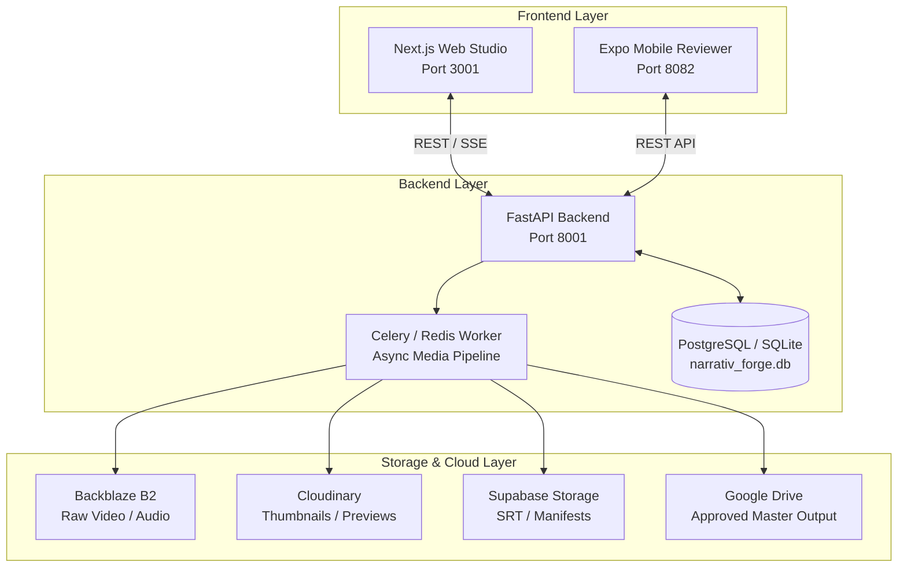

# Narrativ Forge — Master Roadmap & Systematic Execution Plan

**Project Type:** Standalone Private AI Video Production Suite  
**Platforms:** Next.js Web Studio (`http://localhost:3001`), FastAPI Backend (`http://localhost:8001`), Expo Mobile Reviewer (`8082`)  
**Status:** In Active Development & Local Verification  
**Language Specification:** English (Standard Technical Documentation)  
**Last Updated:** October 2026  

---

## 1. System Architecture & Topology

Narrativ Forge is a private, decoupled video creation workflow supporting:
`Idea → Series → Episode → Script → Scenes → Assets → Multi-Track Timeline → Processing → Burmese Subtitles → Review & Approval → Google Drive Export → Publishing Preparation`.

---

## 2. Completed Milestones & Operational Proofs

- [x] **Decoupled Standalone Infrastructure:** Assigned dedicated ports (Web: 3001, API: 8001, Mobile: 8082).
- [x] **Core FastAPI Backend:** Health endpoints `/api/v1/health` and `/` return `HTTP 200 OK`.
- [x] **Burmese Unicode & Subtitle Typography Engine:** Implemented cluster-safe `wrap_myanmar_text` algorithm to prevent broken syllable clusters in ASS/SRT subtitles.
- [x] **Web Studio Platform (25 Pages):** Implemented Next.js app routes for Dashboard, Episodes, Scripts, Scenes, Assets, Subtitles, Review, Auto Mode, Publishing Prep, Production Intelligence, Analytics, and Usage.
- [x] **Multi-Track Visual Timeline Preview:** Added proportional multi-track preview strip displaying visual bars for Script, Scene Prompts, Voiceover, and Background Audio in `apps/web-platform/frontend/app/episodes/[id]/scenes/page.tsx`.
- [x] **Mobile Reviewer & Publisher Client:** Built standalone React Native Expo mobile app (`apps/mobile`) with 9:16 vertical video player, subtitle overlay, one-tap Google Drive approval, and direct share hooks.

---

## 3. Comprehensive Remaining Tasks (Consolidated from Legacy Backlogs)

### Priority 1: Real AI & Burmese ASR Engine Verification
- [ ] **OpenRouter Free Model Fallback Engine:** Finalize automatic model fallback routing (`mistralai/mistral-7b-instruct:free`, `meta-llama/llama-3-8b-instruct:free`, `google/gemma-2-9b-it:free`) when primary quota is exhausted.
- [ ] **Burmese ASR Dialect Verification:** Validate Cloudflare Workers AI Whisper pipeline against local reference transcript audio clips to guarantee >=90% transcription accuracy on Burmese phonemes.
- [ ] **Speech Synthesis (TTS) Integration:** Connect local Edge-TTS and ElevenLabs voice cloning pipelines with Burmese tone pitch compensation.

### Priority 2: Video Composition & Background Worker Runtime
- [ ] **Continuous Worker Heartbeat Verification:** Verify Redis/Celery background worker queue for real non-mock FFmpeg rendering jobs.
- [ ] **Dynamic Subtitle Burn-In:** Render styled Burmese font (Pyidaungsu / Padauk) with configurable font size, outline, and box backgrounds onto output MP4s.
- [ ] **Multi-Resolution Video Export:** Support auto-generation of 9:16 (Shorts/Reels/TikTok) and 16:9 (YouTube) master renders.

### Priority 3: Frontend Multi-Track Visual Timeline & Scene Editor
- [ ] **Drag-and-Drop Track Trimming:** Add interactive clip boundary adjustment (start time, duration, fade in/out) directly on the timeline canvas.
- [ ] **Waveform Visualizer:** Render client-side audio waveforms for uploaded voiceover and background music tracks using Web Audio API.
- [ ] **Live Split-Preview:** Enable real-time frame scrub sync between timeline cursor and video preview player.

### Priority 4: Production Infrastructure & Cloud Deployment
- [ ] **Render Web Service Synchronization:** Align hosted Render services (`Narrativ-Forge` API and `narrativ-forge-frontend`) with the latest main repository commit.
- [ ] **Supabase RLS & Security Function Review:** Audit Supabase Row-Level Security policies to ensure complete tenant isolation across all tables.
- [ ] **Automated Disaster Recovery & Backup Drill:** Execute automated database dump and media asset restore smoke test.

### Priority 5: Mobile App Verification & Social Integrations
- [ ] **EAS Device Build:** Run React Native Expo Application Services (EAS) standalone APK/IPA preview build.
- [ ] **OAuth Direct Publish Token Refresh:** Implement automated OAuth token refresh for TikTok Content Posting API and YouTube Data API v3.
- [ ] **Offline Cache & Network Resilience:** Cache reviewed episode metadata on mobile SQLite/AsyncStorage for offline playback.

---

## 4. Next Systematic Steps

1. **Step 1:** Run full end-to-end media pipeline test locally using `verify_all_backends.py` and frontend typecheck `npx tsc --noEmit`.
2. **Step 2:** Deploy Render API & Frontend updates and verify live HTTPS endpoints.
3. **Step 3:** Perform live Burmese subtitle burn-in verification with FFmpeg.
